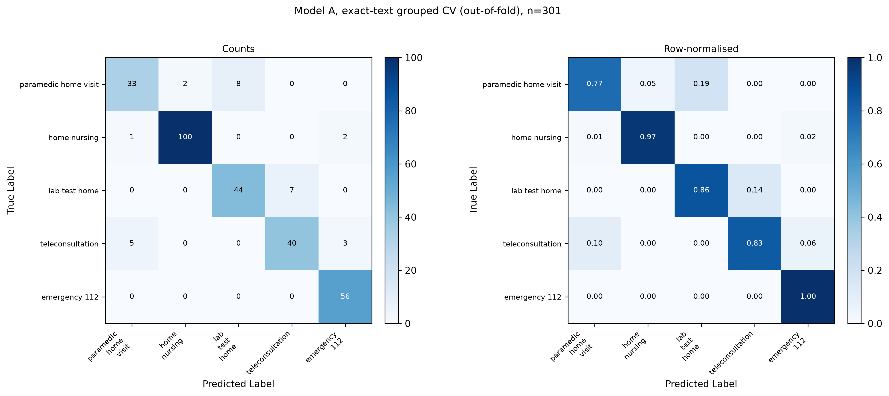

# CareCompass

**Right care. Right caregiver. In seconds.**

CareCompass takes a patient's message in English, Hindi or Hinglish (typed or spoken) and works out three things: **what kind of care they need, how urgent it is, and which nearby caregiver should go**. It explains every answer, and it never diagnoses or prescribes.

> Example: *"Papa ko do din se bukhar hai aur khansi bhi."* → **Teleconsultation or home visit, same day**, with a ranked list of Hindi-speaking caregivers, and a short "why".

Built for **HACK IIITD** (IIIT-Delhi, CAI track: *AI for Healthcare Access*).

> **Not a medical device.** CareCompass routes people to care. It does not diagnose, prescribe or replace a doctor. For emergencies it points to **112**.

---

## Table of contents

1. [Why this exists](#1-why-this-exists)
2. [Our priority: fast and safe first](#2-our-priority-fast-and-safe-first)
3. [What it does](#3-what-it-does)
4. [How it works (architecture)](#4-how-it-works-architecture)
5. [Safety design and guardrails](#5-safety-design-and-guardrails)
6. [Models and results](#6-models-and-results)
7. [Caregiver matching](#7-caregiver-matching)
8. [Tech stack](#8-tech-stack)
9. [Repository structure](#9-repository-structure)
10. [Getting started](#10-getting-started)
11. [Configuration](#11-configuration)
12. [API reference](#12-api-reference)
13. [Supabase setup](#13-supabase-setup)
14. [Running the Android app](#14-running-the-android-app)
15. [Training and evaluating the models](#15-training-and-evaluating-the-models)
16. [Testing and CI](#16-testing-and-ci)
17. [Data and labels](#17-data-and-labels)
18. [Limitations and honest notes](#18-limitations-and-honest-notes)
19. [Further documentation](#19-further-documentation)
20. [Team and acknowledgements](#20-team-and-acknowledgements)

---

## 1. Why this exists

One short sentence like *"Papa ko do din se bukhar hai aur khansi bhi"* hides three separate decisions:

| Decision | Options |
|---|---|
| **What care?** | home nursing, lab test at home, paramedic home visit, teleconsultation, emergency 112 |
| **How urgent?** | emergency, same day, scheduled |
| **Who goes?** | the right caregiver by language, distance, skill and rating |

Today, a person makes all three by hand. It is slow and inconsistent. It is also hard to automate, because:

- Hinglish spellings change every time ("bukhar", "bukhaar", "bukar").
- Labelled data is tiny.
- **Missing an emergency is the worst possible mistake.**

---

## 2. Our priority: fast and safe first

CareCompass is built for the moment someone does not know what to do. In that moment a **fast, cautious answer matters more than a perfect one**. Pinning down the exact diagnosis is the doctor's job. Ours is to get the person to the right kind of help quickly.

- **Speed:** an answer in seconds, not a queue.
- **Safety:** when unsure, raise urgency. Never lower it.
- **Hand-off:** a real doctor or caregiver always confirms.

This is why the two kinds of mistake are treated differently. A missed emergency is the one we design against. Extra caution (a mild case sent to a faster option, or asked one more question) is annoying but not dangerous.

---

## 3. What it does

- **Understands Hinglish, Hindi and English**, in Roman or Devanagari script, including spelling variants and negation ("saans me koi dikkat nahi").
- **Classifies the care type** (5 classes) and **maps it to urgency** (3 levels).
- **Detects 9 red flags** and escalates to 112 with first-aid steps.
- **Asks at most 2 follow-up questions**, from a fixed closed bank.
- **Explains every answer**: top contributing words and the most similar training examples.
- **Matches caregivers** by language, distance, skill and rating, with hard filters for role, availability and radius.
- **Books, cancels and reschedules** appointments, with history of the latest sessions.
- **Voice input** via on-device Android speech recognition (optional server-side Whisper).
- **Optional context**: weather and air quality (Open-Meteo) and season, only with the user's consent.
- **Runs without keys**: falls back to SQLite and to ML plus rules if no LLM key is set.

---

## 4. How it works (architecture)

```
User message (text or voice)
        │
        ▼
┌───────────────────────────────────────────────┐
│ 1. Intake and normalisation                   │
│    script detection, transliteration,         │
│    spelling variants, negation scope          │
└───────────────────┬───────────────────────────┘
                    ▼
┌───────────────────────────────────────────────┐
│ 2. Safety check                               │
│    9-flag rule layer + LLM screen             │
│    (can only RAISE urgency)                   │──► Emergency: 112 + first steps
└───────────────────┬───────────────────────────┘
                    ▼
┌───────────────────────────────────────────────┐
│ 3. ML models decide                           │
│    Model A: TF-IDF char n-grams + calibrated  │
│             logistic regression → care type   │
│    Red-flag ML model (multi-label, 9 flags)   │
│    Urgency follows from care type             │
└───────────────────┬───────────────────────────┘
                    ▼
┌───────────────────────────────────────────────┐
│ 4. LLM second opinion (in parallel)           │
│    agree        → confidence goes up          │
│    more severe  → ask ONE confirmation question│
│    less severe  → ignored (never lowers)      │
└───────────────────┬───────────────────────────┘
                    ▼
┌───────────────────────────────────────────────┐
│ 5. Match and explain                          │
│    filter caregivers, score, rank,            │
│    explanation + one-tap booking              │
└───────────────────────────────────────────────┘
```

**The roles in one line:** *ML decides. The LLM advises. Rules protect.*

If the LLM is down or no key is set, the ML models and rules still answer, and the 112 emergency screen is hardcoded in the app.

### Emergency policy

An emergency is declared only with **evidence**: a quoted red flag, the user's "yes" to a confirmation question, or P(emergency_112) ≥ 0.5 from the classifier. A scary-sounding word on its own is not enough.

---

## 5. Safety design and guardrails

| # | Guardrail | What it does |
|---|---|---|
| 1 | **Rules + LLM safety screen** | 9 red flags are checked by rules and by an LLM screen. Both can only raise urgency. |
| 2 | **Emergency needs evidence** | A quoted red flag or the user's "yes". |
| 3 | **The LLM never lowers** | A less-severe LLM opinion is ignored. A more-severe one triggers one question. |
| 4 | **Two questions, max** | Follow-ups come from a closed bank. No free-form interrogation. |
| 5 | **No diagnosis, no drugs** | Output guard plus scope refusal. Every answer carries "call 112 if it gets worse". |
| 6 | **Private by default** | Personal details are masked in logs. Context lookups are opt-in. Data is synthetic only. |

Why have an LLM screen at all? On fresh wordings (35 emergency messages written differently from the training data), **keyword rules alone caught 2 of 35**, and the LLM screen plus a confirmation question caught **34 of 35**. This is on an AI-drafted test set, so treat it as preliminary. The LLM is a safety net only: it never works alone.

Policy files live in `config/guardrails.yaml`, `app/data/red_flags.yaml`, `app/data/guardrail_lexicon.yaml` and `app/data/emergency_steps.yaml`. See [docs/SAFETY_LOGIC.md](docs/SAFETY_LOGIC.md), [docs/RESPONSE_POLICY.md](docs/RESPONSE_POLICY.md) and [docs/GUARDRAIL_REPORT.md](docs/GUARDRAIL_REPORT.md).

---

## 6. Models and results

### Models used

| Role | Model | Notes |
|---|---|---|
| **Care-type classifier (production)** | **Model A**: TF-IDF (char 2–5 + word 1–2) + sigmoid-calibrated Logistic Regression | 1.2 MB, under 0.5 ms per prediction |
| Red-flag detector | Multi-label ML model, 9 flags | Reads meaning, not just keywords |
| Challenger | Model C: TF-IDF + multilingual-e5-small ensemble | Did not qualify (see below) |
| Second opinion | LLM (DeepSeek by default, provider-agnostic) | Second opinion, safety screen, fallback slot extraction |
| Rules | 9-flag keyword and pattern layer | Fast and certain on known phrasings |

**Why Model A?** It beat the larger embedding ensembles on the main, leak-free figure, at about 1/400th of the size.

| Metric (care-type classifier, macro-F1) | Model A | Model C | C_stack |
|---|---|---|---|
| Exact-text grouped cross-validation (main figure) | **0.879** | 0.841 | 0.841 |
| 30 unseen tests (AI-drafted) | **0.866** | 0.828 | n/a |

"Exact-text grouped" means every identical text sits in one fold, so no test text was ever seen in training. This is the figure we trust. The dataset has only about 54 unique texts, so identical-text leakage is a real risk, and we avoid it on purpose.

### Other results (all preliminary, synthetic data)

- **Emergency recall:** 56 / 56 on the official data.
- **Fresh-wording emergencies:** 34 / 35 with LLM screen and confirmation.
- **Calibration:** ECE 0.078, Brier 0.028.
- **LLM latency (p95):** about 3.2 s for the safety screen and about 7 s for the second opinion.
- **End to end on the 340 official rows:** 0.59 accuracy among rows where the system decides, and 0.54 if follow-up questions count as misses. This is lower than the classifier alone, and we report it rather than hide it.

### Confusion matrix

Classifier alone, exact-text grouped CV, 301 rows:



More figures are in `docs/figures/`: full-pipeline matrix, unseen-set matrix, red-flag hold-out matrix and reliability plots. See [docs/MODEL_CARD.md](docs/MODEL_CARD.md), [docs/MODELS_USED.md](docs/MODELS_USED.md) and [docs/MODEL_COMPARISON.md](docs/MODEL_COMPARISON.md).

> Do not use `docs/confusion_matrix_LEAKY_do_not_use.png` or `docs/calibration_plot_LEAKY_do_not_use.png`. They come from an earlier split that leaked identical texts and overstate performance.

---

## 7. Caregiver matching

Candidates are first filtered, then scored.

**Hard filters:** role must fit the care type, caregiver is active, within radius (doctors skip the distance check), and has a free time window.

**Score:**

```
score = 0.35 × language + 0.30 × proximity + 0.20 × skill + 0.15 × rating
```

| Factor | Weight | Meaning |
|---|---|---|
| Language | 0.35 | Speaks the patient's language |
| Proximity | 0.30 | Haversine distance (closer is better) |
| Skill | 0.20 | Fit for the care type |
| Rating | 0.15 | Normalised rating |

Free one-hour slots are available per caregiver per date. Bookings must be in the future and inside the caregiver's window.

Matching code: `app/core/matching.py`. Demo caregivers: `app/data/caregivers_synthetic.csv` (synthetic, 60 caregivers).

---

## 8. Tech stack

| Layer | Tools | Why |
|---|---|---|
| **App** | Kotlin, Jetpack Compose, Material 3, MVVM, Retrofit, Android SpeechRecognizer and TextToSpeech | Big buttons, voice, no typing needed |
| **API** | FastAPI, Pydantic v2, Uvicorn, Docker Compose, pytest, GitHub Actions | Matches the organisers' JSON format, one-command run |
| **ML** | scikit-learn, LightGBM, sentence-transformers (multilingual-e5-small), PyTorch, joblib | Small data, tiny and fast model, trustworthy confidence |
| **LLM** | DeepSeek, behind a swappable `LLM_PROVIDER` setting (Groq also supported) | Reads messy Hinglish for the second opinion, never the final call |
| **Speech** | On-device Android recognition; optional Groq Whisper (`STT_PROVIDER=groq_whisper`) | Works without a server key |
| **Data** | SQLite (default fallback), Supabase Postgres + Auth with Row-Level Security | Bookings and history, per-user isolation |
| **Context** | Open-Meteo weather and air quality (with consent) | Heat-wave and AQI escalation for vulnerable patients |

Python 3.11 (CI and Docker image).

---

## 9. Repository structure

```
Care-Compass/
├── app/                      # FastAPI backend
│   ├── main.py               # app entry point, routers, CORS
│   ├── config.py             # settings from environment
│   ├── schemas.py            # Pydantic request/response models
│   ├── api/                  # endpoints: triage, caregivers, booking(s),
│   │                         #   history, transcribe, health, synthetic
│   ├── core/                 # the brains
│   │   ├── pipeline.py       #   orchestrates the whole flow
│   │   ├── language.py       #   script detection, transliteration, negation
│   │   ├── intake.py         #   slot extraction (LLM + deterministic fallback)
│   │   ├── red_flags.py      #   9-flag rule layer
│   │   ├── redflag_model.py  #   ML red-flag detector
│   │   ├── semantic_screen.py#   LLM safety screen
│   │   ├── triage_model.py   #   Model A classifier
│   │   ├── second_opinion.py #   LLM second opinion + reconcile
│   │   ├── care_decision.py  #   final care type and urgency
│   │   ├── risk_modifiers.py #   age, pregnancy, chronic conditions
│   │   ├── guardrails.py     #   output guard, scope refusal
│   │   ├── explain.py        #   top features, nearest examples
│   │   ├── matching.py       #   caregiver scoring
│   │   ├── context.py        #   weather, AQI, season
│   │   ├── llm.py, stt.py    #   provider-agnostic LLM and speech
│   │   └── auth.py           #   Supabase JWT verification
│   ├── db/                   # SQLite and Supabase stores
│   └── data/                 # lexicons, red flags, symptoms, steps,
│                             #   Hinglish normalisation, synthetic caregivers
├── ml/                       # training, evaluation, datasets, artifacts
│   ├── data/                 # official dataset, splits, test sets
│   ├── artifacts/            # trained .joblib models
│   ├── results/              # metrics, predictions, verification workbook
│   └── *.py                  # train / evaluate / plot scripts
├── android/                  # Kotlin + Jetpack Compose app
├── supabase/schema.sql       # tables, indexes, RLS policies (idempotent)
├── config/guardrails.yaml    # clinical safety and response policy
├── scripts/                  # run_dev, smoke tests, check, golden, seeding
├── tests/                    # pytest suite + golden_scenarios.yaml
├── docs/                     # model card, safety logic, reports, screenshots
├── Dockerfile, docker-compose.yml, requirements.txt, pytest.ini
└── .github/workflows/ci.yml  # CI: tests + golden scenarios + secret scan
```

---

## 10. Getting started

### Option A: Docker (one command)

```bash
git clone https://github.com/<your-org>/Care-Compass.git
cd Care-Compass
cp .env.example .env        # optional: add an LLM key
docker compose up --build
```

- API docs (Swagger): http://localhost:8000/docs
- Health: http://localhost:8000/health

### Option B: Local Python

Requirements: Python 3.11, pip.

```bash
git clone https://github.com/<your-org>/Care-Compass.git
cd Care-Compass

python3 -m venv .venv
source .venv/bin/activate          # Windows: .venv\Scripts\activate
pip install -r requirements.txt

cp .env.example .env               # optional: add an LLM key

./scripts/run_dev.sh               # starts uvicorn on port 8000 with reload
```

Trained models are included in `ml/artifacts/`, so you can run the API straight away. The first run may download `multilingual-e5-small` from Hugging Face if you use the embedding features.

### No API keys? It still works

- **No LLM key:** the ML models and rules still answer. The LLM safety screen and second opinion are skipped.
- **No Supabase:** chat history and bookings use a local SQLite file (`carecompass.db`).
- **No speech key:** voice uses on-device Android recognition only.

### Try it

With the server running:

```bash
curl -X POST http://localhost:8000/triage \
  -H "Content-Type: application/json" \
  -d '{"user_input":"papa ko do din se bukhar hai aur khansi bhi","language":"hinglish"}'
```

Or run the bundled smoke tests:

```bash
./scripts/smoke_test.sh
```

They check: health, a vague fever (follow-up question), Hinglish chest pain (emergency), a negation case ("saans me koi dikkat nahi"), caregiver matching, booking and transcription.

---

## 11. Configuration

Copy `.env.example` to `.env`. Never commit `.env`.

| Variable | Default | Purpose |
|---|---|---|
| `LLM_PROVIDER` | `deepseek` | `deepseek` or `groq` |
| `LLM_BASE_URL` | empty | Override the OpenAI-compatible endpoint |
| `LLM_MODEL` / `LLM_FAST_MODEL` | `deepseek-v4-pro` / `deepseek-flash` | Main and fast model names |
| `DEEPSEEK_API_KEY`, `GROQ_API_KEY` | none | Provider keys. Leave empty to run without the LLM |
| `LLM_TIMEOUT_S` | `3.0` | LLM call timeout |
| `STT_PROVIDER` | empty | `groq_whisper`, `local_whisper` or `android_only` |
| `HOST`, `PORT` | `0.0.0.0`, `8000` | Server bind |
| `DATABASE_URL` | `sqlite:///./carecompass.db` | SQLite fallback store |
| `SUPABASE_URL` | empty | Enables Supabase when set with the keys below |
| `SUPABASE_SERVICE_ROLE_KEY` | empty | Server-side key (bypasses RLS). Keep secret |
| `SUPABASE_JWT_SECRET` / `SUPABASE_JWKS_URL` | empty | Verify user tokens (HS256, or RS256/ES256 via JWKS) |
| `ENV` | `dev` | In `dev`, `DEV_USER_ID` can stand in for a real token |
| `DEV_USER_ID` | empty | Dev-only fake user id |
| `MODEL_VERSION` | `1.0.0` | Reported in `/health` |

> The `docker-compose.yml` passes `DEEPSEEK_API_KEY` from your shell or `.env`. If you use Supabase with Docker, add the Supabase variables to the `environment:` block too.

---

## 12. API reference

Interactive docs: `http://localhost:8000/docs`.

| Method | Path | Auth | Purpose |
|---|---|---|---|
| GET | `/health` | no | Status, model version, store (`sqlite` or `supabase`) |
| POST | `/triage` | optional | Main entry: message → care type, urgency, red flags, matches, explanation |
| POST | `/match` | no | Rank caregivers for a care type and urgency |
| GET | `/caregivers` | no | List caregivers |
| GET | `/caregivers/{id}/slots?date=YYYY-MM-DD` | yes | Free 1-hour slots |
| POST | `/book` | yes | Book a caregiver |
| GET | `/bookings?status=upcoming` | yes | List the user's bookings |
| GET | `/bookings/{id}` | yes | One booking |
| POST | `/bookings/{id}/cancel` | yes | Cancel (owner only) |
| POST | `/bookings/{id}/reschedule` | yes | Reschedule |
| GET | `/history?limit=5` | yes | Latest sessions |
| GET | `/history/{session_id}` | yes | Summary, ordered steps, booking |
| DELETE | `/history/{session_id}` | yes | Delete a session |
| POST | `/transcribe` | no | Validate or normalise a speech transcript |
| GET | `/synthetic-caregivers` | no | Demo caregivers |

`/triage` works with or without a token. History is logged only when a valid token is present. Authenticated endpoints need `Authorization: Bearer <supabase-access-token>`.

### `POST /triage`

Request (main fields):

```json
{
  "user_input": "papa ko do din se bukhar hai",
  "language": "hinglish",
  "location": {"lat": 28.5459, "lng": 77.2732},
  "conversation_history": [],
  "context_consent": false,
  "session_id": null
}
```

Response (main fields): `care_type`, `urgency`, `red_flags`, `reasoning`, `confidence`, `follow_up_question`, `follow_up_options`, `matched_caregivers`, `emergency_steps`, `second_opinion`, `disclaimer`, `session_id`.

If `follow_up_question` is set, the app asks it, then calls `/triage` again with the answer in `conversation_history`.

### More examples

```bash
# Last 5 sessions
curl "http://localhost:8000/history?limit=5" -H "Authorization: Bearer $ACCESS_TOKEN"

# Book (start_time must be future, inside the caregiver's window)
curl -X POST http://localhost:8000/book \
  -H "Authorization: Bearer $ACCESS_TOKEN" -H "Content-Type: application/json" \
  -d '{"caregiver_id":"CG_001","care_type":"teleconsultation","patient_name":"Rohan","start_time":"2026-11-01T14:00:00Z"}'

# Free slots
curl "http://localhost:8000/caregivers/CG_001/slots?date=2026-11-01" -H "Authorization: Bearer $ACCESS_TOKEN"

# Cancel / reschedule
curl -X POST http://localhost:8000/bookings/$BOOKING_ID/cancel -H "Authorization: Bearer $ACCESS_TOKEN"
curl -X POST http://localhost:8000/bookings/$BOOKING_ID/reschedule \
  -H "Authorization: Bearer $ACCESS_TOKEN" -H "Content-Type: application/json" \
  -d '{"start_time":"2026-11-02T10:00:00Z"}'
```

---

## 13. Supabase setup

Optional. Without it, the backend uses SQLite.

1. Create a project at https://supabase.com. Note the **Project URL** and **Project Ref**.
2. In **Project Settings → API**, copy the `anon` key (for the app), the `service_role` key (for the backend) and the **JWT Secret**.
3. Enable **anonymous sign-in** under Authentication → Providers (or use email or social login).
4. In the **SQL Editor**, run `supabase/schema.sql`. It is idempotent and creates tables, indexes and Row-Level Security policies.
5. Seed caregivers: `python scripts/seed_caregivers.py`
6. Put the values in `.env`:
   ```
   SUPABASE_URL=https://<ref>.supabase.co
   SUPABASE_SERVICE_ROLE_KEY=<service_role_jwt>
   SUPABASE_JWT_SECRET=<jwt_secret>
   ```
7. Check `GET /health`. It reports `store: "supabase"` when configured and reachable.

**History retention:** the app shows the latest 5 sessions. Older sessions stay in the database for audit.

**Auth:** the backend verifies the JWT, checks `exp` and `aud == "authenticated"`, and uses `sub` as the user id. For local development, set `ENV=dev` and `DEV_USER_ID` to skip minting a token.

**Security:** never commit `.env` or the service-role key. `scripts/scan_secrets.py` runs in CI to catch leaks.

---

## 14. Running the Android app

Requirements: Android Studio, Java 17+, Android Gradle Plugin 8.3+, Kotlin 1.9+, an emulator on API 26 or higher.

1. Start the backend (section 10).
2. Open Android Studio → **Open** → select the `android/` folder.
3. Wait for Gradle sync.
4. Start an emulator.
5. Click **Run 'app'** (Shift+F10).

The emulator reaches your computer's backend at `http://10.0.2.2:8000/`. Cleartext HTTP is enabled for development only. For a physical phone, change the base URL to your computer's LAN address and keep both on the same network.

**Voice:** the app uses the on-device `SpeechRecognizer` (`hi-IN`, `en-IN`) and sends the transcript to `/transcribe` for normalisation.

**Context:** location-aware weather and air quality are strictly opt-in and can be turned off any time.

**Screens:** Home, Chat, Result, Emergency, Booking flow, Bookings, History, and symptom module cards. Screenshots are in `docs/` (`home_screen.png`, `result_screen.png`, `android_*.png`).

Android unit tests: `cd android && ./gradlew test`

---

## 15. Training and evaluating the models

All scripts run from the repo root.

```bash
python -m ml.prepare_data         # build train / val splits from the official dataset
python -m ml.train_triage         # train the care-type classifier
python -m ml.train_redflag_model  # train the multi-label red-flag model
python -m ml.evaluate             # metrics
python -m ml.predict_test         # predictions on test sets
python -m ml.compare_models       # Model A vs C vs C_stack
python -m ml.regenerate_plots     # confusion matrices and reliability plots (grouped CV)
```

Other evaluation scripts in `ml/`: `eval_second_opinion.py`, `eval_semantic_screen.py`, `eval_guardrails.py`, `eval_redflag_rules.py`, `audit_overrides.py`, `measure_triage_latency.py`, `measure_llm_latency.py`, `explain_model.py`.

Some evaluations call an LLM and need a key. Their outputs are cached locally in `ml/results/llm_cache.jsonl`, which is git-ignored.

Metrics and predictions are saved in `ml/results/`. See `ml/README.md` and `ml/data/README.md` for details.

---

## 16. Testing and CI

```bash
# everything CI runs: pytest + golden scenarios (LLM mocked) + secret scan
./scripts/check.sh

# or individually
python -m pytest -q
python scripts/run_golden.py
python scripts/scan_secrets.py
```

The test suite covers triage levels, red flags, negation, follow-up policy, no-banned-questions, guardrails, matching, Supabase auth, bookings and history, language consistency, input noise, fairness, pregnancy risk, the STT provider, provider switching and the API contract. `tests/golden_scenarios.yaml` holds end-to-end scenarios that run with the LLM mocked, so CI needs no keys.

GitHub Actions (`.github/workflows/ci.yml`) runs `scripts/check.sh` on every push and pull request (Python 3.11).

---

## 17. Data and labels

**Dataset:** *Sanocare synthetic care-triage dataset v1 (2026), provided for the IIIT-Delhi hackathon.* It is synthetic: **340 rows, about 54 unique texts, 60 caregivers**. We also use AI-drafted paraphrases and test sets, labelled as such in `ml/data/`.

| Label | Values |
|---|---|
| **Care types** | `paramedic_home_visit`, `home_nursing`, `lab_test_home`, `teleconsultation`, `emergency_112` |
| **Urgency** | `emergency`, `same_day`, `scheduled` (derived from care type via `CARE_TO_URGENCY`) |
| **Red flags** | `chest_pain`, `breathlessness`, `unconsciousness`, `severe_bleeding`, `stroke_symptoms`, `seizure`, `high_fever_infant`, `suicidal_ideation`, `severe_dehydration` |

All data is synthetic. No real patient data is used. See [docs/DATA_AUDIT.md](docs/DATA_AUDIT.md) and [docs/TAXONOMY.md](docs/TAXONOMY.md).

---

## 18. Limitations and honest notes

- **Synthetic, small data.** About 54 unique texts means scores are optimistic and confidence intervals are wide. Treat every number as **preliminary**.
- **AI-drafted test sets.** The "unseen" and fresh-wording tests were drafted by AI, not clinicians or real users. A human-written test set is a next step.
- **End-to-end is weaker than the classifier alone** (0.59 / 0.54 on the 340 official rows, against 0.879 grouped-CV macro-F1 for the classifier). The gap is mostly follow-up questions and the safety-first policy.
- **Red flags and care-type labels need clinician review.**
- **LLM latency** adds about 3 s (screen) to 7 s (second opinion) at p95. The ML path alone is far faster.
- **Not a medical device.** No diagnosis, no prescribing. A human always confirms.
- **Caregivers are synthetic.** Real calendars, privacy and hosting are not built yet.

---

## 19. Further documentation

| Doc | What is in it |
|---|---|
| [docs/MODEL_CARD.md](docs/MODEL_CARD.md) | Intended use, architecture, selection rationale, metrics |
| [docs/MODELS_USED.md](docs/MODELS_USED.md) | Every model and its role |
| [docs/MODEL_COMPARISON.md](docs/MODEL_COMPARISON.md) | Model A vs C vs C_stack |
| [docs/SAFETY_LOGIC.md](docs/SAFETY_LOGIC.md) | How red flags, emergency and escalation work |
| [docs/RESPONSE_POLICY.md](docs/RESPONSE_POLICY.md) | What the app may and may not say |
| [docs/GUARDRAIL_REPORT.md](docs/GUARDRAIL_REPORT.md) | Guardrail evaluation |
| [docs/FAIRNESS_REPORT.md](docs/FAIRNESS_REPORT.md) | Language and fairness checks |
| [docs/ROBUSTNESS_REPORT.md](docs/ROBUSTNESS_REPORT.md) | Noise, typos, edge cases |
| [docs/DATA_AUDIT.md](docs/DATA_AUDIT.md) | Dataset audit |
| [docs/TAXONOMY.md](docs/TAXONOMY.md) | Label definitions |
| [docs/WRITEUP.md](docs/WRITEUP.md) | Project write-up |
| [ml/README.md](ml/README.md) | ML pipeline and training |

---

## 20. Team and acknowledgements

Team CareCompass, **HACK IIITD**, IIIT-Delhi (CAI track: *AI for Healthcare Access*).

Dataset: *Sanocare synthetic care-triage dataset v1 (2026)*, provided by the organisers.

Weather and air quality: [Open-Meteo](https://open-meteo.com/).

_Add team member names, licence and contact details here._
